# robbie_ros

[](LICENSE)
[](#)
[](https://en.wikipedia.org/wiki/Technology_readiness_level)
[](https://docs.ros.org/en/jazzy/)
[](https://mujoco.org/)
[](https://rerun.io/)
[](https://www.raspberrypi.com/products/raspberry-pi-4-model-b/)
[](https://www.python.org/)
[](https://isocpp.org/)
[](https://youtu.be/8_o7KxZShpw)
[](https://github.com/busyDuckman/robbie)
[](https://github.com/busyDuckman/robbie_ros/actions/workflows/test.yml)

Robot control for Robbie, a desktop robot with a moving head and two round LCD eyes.

robbie_ros is a ROS 2 system. It runs on a Raspberry Pi 4, or on the PC for simulation.

> Status: ROS 2 setup, deployment to the Pi-4 works, MuJoCo simulation.

## 1.0 Position in the larger Robbie project

Robbie is built in four layers:

- **A, the LLM.** AI control and dialogue.
- **B, the harness.** State, attention, mood, camera, microphone and speakers.
- **C, robot control.** This repo. Drives the neck motors, reads the sensors, runs gaze motion, and renders the eyes.
- **D, physical layer.** Robot physical design and CAD files.

Layers A and B live in the [robbie] repo. Layer D CAD files are in [robbie_openscad].

This repo holds **layer C**, and provides the **layer D** neck joint design, because that requires the MuJoCo simulator.

The harness talks to robbie_ros through a single ROS 2 bridge node. Nothing else in the
harness uses ROS. Standard ROS 2 message types are used where possible, so another ROS 2
robot could stand in for robbie_ros by remapping topics.

## 2.0 What robbie_ros does

Firmware:
- **Neck control.** Turns a desired head pose into sled motion, and keeps the sleds from colliding.
- **Homing.** Works out where the sleds are at power-on, using the encoders and a single
  shared home switch. It must work whatever order the sleds were assembled in.
- **Gaze.** Turns gaze targets from the harness into natural motion using [lookaround].
- **Unwinding.** The head can yaw through several full turns. robbie_ros unwinds it when
  needed, overriding or reinterpreting harness requests to do so.
- **Eyes.** Draws and animates the two eyes (gaze, blinks, lids, expression).
- **Safety.** Enforces joint limits, and stops safely if the harness goes silent or the
  e-stop is pressed.
- **Reporting.** Sends the harness the timestamped camera pose, whether the gaze target is
  reachable, status, and a heartbeat.

Simulation:
- A virtual Robbie to play with.
- Resolves part specs to make a well-behaved neck linkage, and explains/demonstrates the trade-offs in play.
- Allows the development of the IK solver.

## 3.0 The hardware

### 3.1 The neck

- Three motorised sleds orbit a ring gear on a shared track.
- Three rods link the sleds to the head platform.
- Three springs each join a pair of neighbouring rods.
- Sleds spaced at 120° give a level head.
- Moving them in unison yaws the head, with unlimited turns.
- Moving them out of unison angles the head (roll/pitch).
- The sleds use geared N20 motors that can't be back-driven, so motor power can be cut once a pose is reached.

- The springs only return the system to one of two stable poses.
   - They don't affect the dynamics, so any reasonable springs work.
   - It looks a lot like a three-sided tensegrity prism, but it's different. Like a tensegrity prism, the rods
     lock to a stable pose, but because the top and lower platforms are fixed (not flexible) the vertical ropes
     are not needed.
   - If the 3-legged platform is fully torsioned (either way) it becomes stable, because it binds the movement
     limits of the upper and lower rod ends.
   - The springs do nothing except ensure that we don't leave the bound state.
   - Manipulating the lower rod positions now controls the roll/pitch of the top platform.
   - Yaw comes from all 3 moving together.

**Notes for AI agents**: I have not found an AI agent that can figure out how the neck works. Any AI attempting to directly work on the neck should be wary; it is very likely to make mistakes.

### 3.2 Sensors and outputs
- One AS5600 magnetic encoder per sled pinion, one on each of the Pi's I2C buses.
- One home switch, pressed by every sled as it passes.
- Two GC9A01 round SPI LCDs for eyes.

### 3.3 Photos etc.
These photos are quite old; this repo is a re-implementation (using modern tools) of a device I made quite a few years ago.

<p>
  
  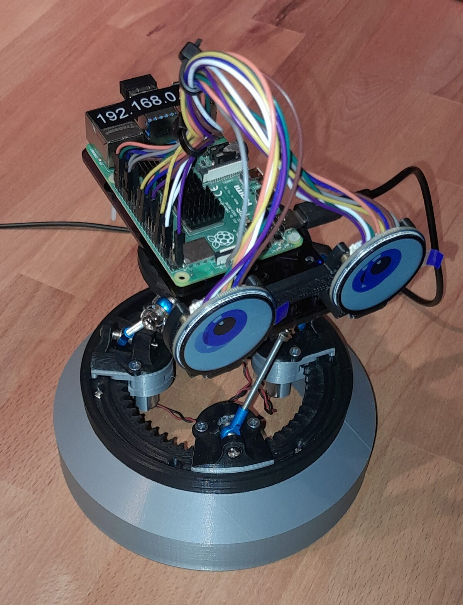
</p>

Assembly animation (from [robbie_openscad]):

<a href="https://youtu.be/8_o7KxZShpw">
  
</a>

## 4.0 Simulation

The simulation uses MuJoCo for physics and Rerun for visualisation and logging. It plugs in at the
hardware driver, so everything above the driver is the same code in sim and on the Pi.


From Linux or a WSL shell, after `just setup`:

```
just up              # build, then start the sim
just up --headless   # without the windows
just down            # stop the simulation (don't just close the window)
```

`just up` also opens a small GUI for driving the robot's joints, etc.

It also logs the neck to Rerun: the linkage and nod lines in 3D, with head roll/pitch/yaw, off centre and the sleds
over sim time. `just setup` asks where the viewer is (`ROBBIE_RERUN` in `.env`): `local` runs one in the dev
container, or give the `host:port` of your own (same version as `rerun-sdk` in [requirements.txt]). With
`--headless`, a local viewer is replaced by a recording in `.output/rerun/`.

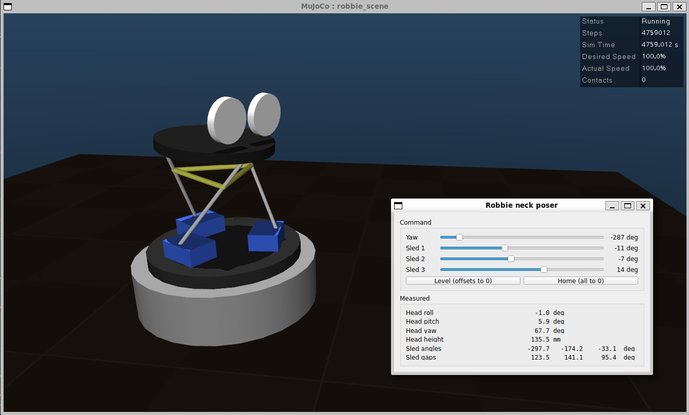

**Notes**

- The geometry is defined in [neck.yaml], and the MuJoCo model is rebuilt from it at "just up".
- The rod ends jamming creates a fully stable pose, working in concert with the springs, which effectively
  torsion the system into the jam. But the exact jamming angle of the ball joint is not measured.
- So there is a **gap between the simulation and reality** that probably changes with the brand of push-rod end used.
- The simulation's springs are also stiffer than the real ones. Softer springs in the sim result in the system
  moving to the other twist pose (stable pole) when doing large/fast movements. In reality that's not possible
  without significant external force.

## 5.0 Design of the neck linkage

The system is non-trivial, so I used the simulation to study the behaviour.

**Important terms used from now on**:
  - **Graceful**: no unwanted roll, jerky motion, or going off centre.
    - |roll| <= 1° and off centre <= 10 mm.
  - **Ugly**: by any means necessary.
  - **Resting pose**: the sleds evenly spaced at 120°, and the platform level.
  - **CW state**: looking from the top, the manual clockwise torsioning of the neck joint to a stable pose.
  - **CCW state**: looking from the top, the manual counter-clockwise torsioning of the neck joint to a stable pose.
  - **Nod line**: in the _resting pose_, nod lines lie halfway between each sled linkage and its matching upper platform linkage.
    - A head facing along a nod line can make its largest graceful pitch in either up or down.
    - A head facing 60° left or right of a _nod line_ has the opposite graceful pitch allowance.

### 5.1 Overview
We essentially have a tensegrity-like prism for a neck joint, which transforms the sled orientation into a platform roll/pitch. This system is not perfect; it performs some motions really well, and others quite poorly. And that's actually OK, provided we get the system behaving well where it counts.

Things a head joint must do _gracefully_:
  - look up and down (pitch)
  - turn side to side (yaw)
  - track between positions smoothly.

Things a neck must be able to do, _ugly_:
  - tilt to the side (roll)
  - lateral movements.

The linkage's dynamics change according to:
  - rod length
  - jam angle of the push-rod linkage
  - radius of the upper platform
  - radius of the sled linkages.

To simplify the system a bit, the last two can be condensed down to
the ratio of the two radii. Further, the ratio has its own trade-off:
structural strength vs speed of motion. There is also the issue of bad ratios
providing enough leverage to back-drive the motors.

Experimentally (having tested on a real-life setup) I think the best ratio is
about 0.9 (with the top being smaller). For the current setup we will use 0.93,
because it keeps the top hexagon size a nice round number.

If you want to scale the size in robbie_openscad, just scale the rod lengths to match and
all the charts below should still work.

**tl;dr** So now we have a stable system that does not back-drive the motors, and we need
to tune in the rod length and the jam angle of the sled linkage.

**Note:** What follows is a generalised analysis aimed at helping people build a working Robbie, with the linkages they purchased and whatever modifications they choose. At a pragmatic level the statements are broadly true, and quite useful.

**Want these charts for a custom Robbie?**, two options:
  - Edit [neck.yaml], then run `just plot`. Plots are saved to `.plots/` after the simulation finishes.
  - or; run "just config" and go through the tabs.

### 5.2 What is the available movement?
As you might expect, the movement limits have a 3-fold rotational symmetry.
A minority of poses have only one solution, and it's uncommon to see more than 3 solutions (left). Going beyond a 5° roll or pitch is not always possible, but a 15° pitch is possible in the regions the neck needs to be able to do so.

The movement of the head can go off centre. Areas where we saw many solutions also tend to offer a _graceful_ solution (middle).

The difference between solutions can easily move the head's centre 10 to 20 mm (right), so picking a good solution is vital to smooth movement.

<table>
  <tr>
    <td>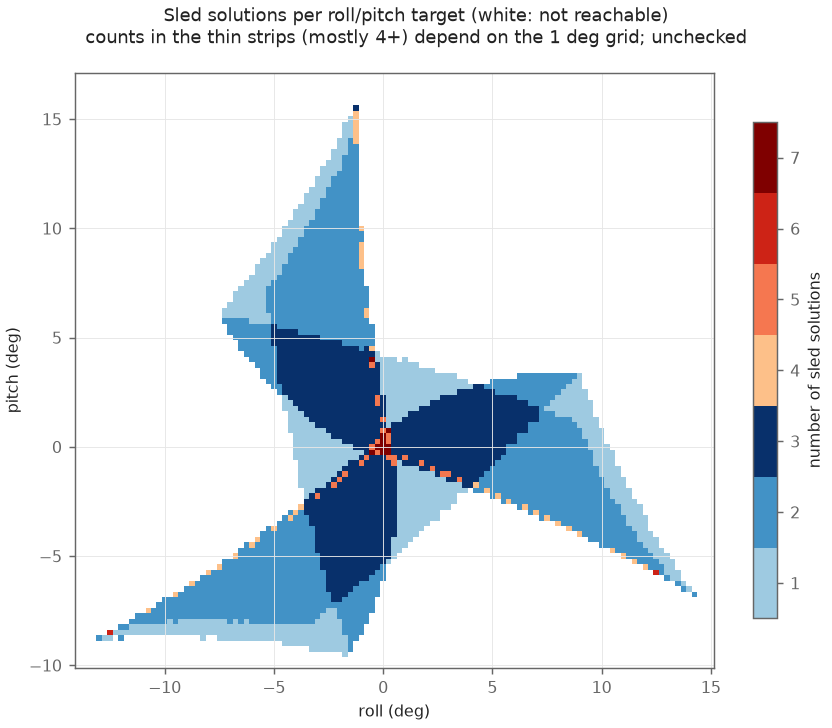</td>
    <td>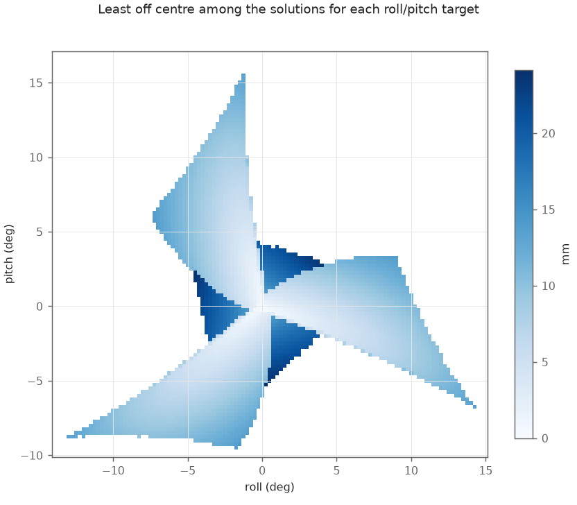</td>
    <td>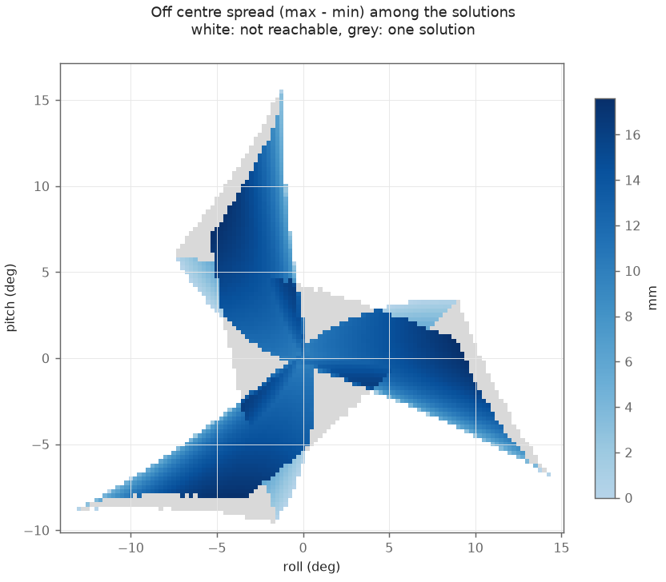</td>
  </tr>
  <tr>
    <td align="center">Left: solutions per target</td>
    <td align="center">Middle: least off centre</td>
    <td align="center">Right: off-centre spread</td>
  </tr>
</table>

### 5.3 Rod length trade-off

The quickest way to get more movement is to shorten the rods.

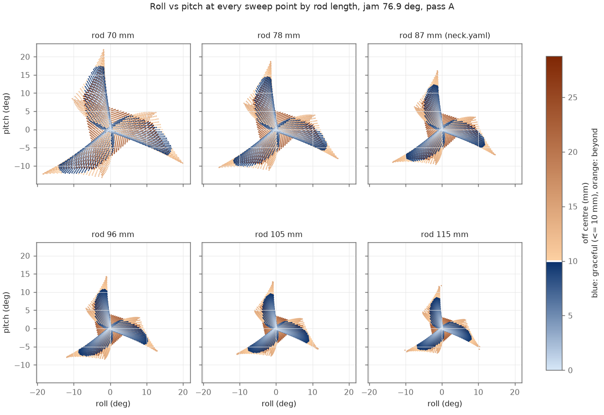

The trade-off is that the head is more sensitive; sled error or backlash moves the head about 40% more, and there is more available torque to back-drive the motors when at rest. So hey, it's the effect of a longer lever (woah).

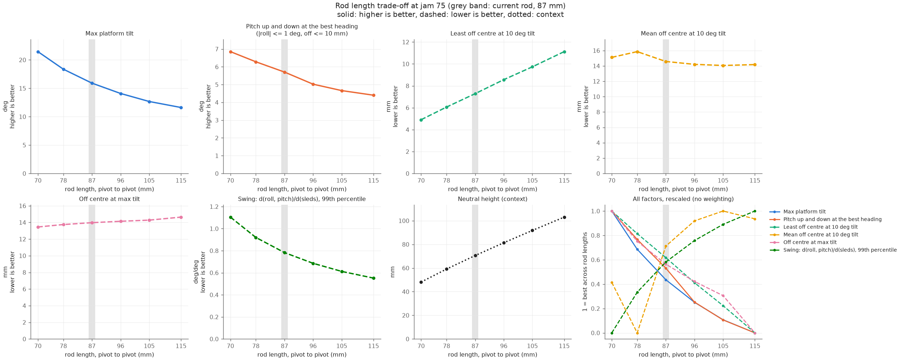

### 5.4 Jam angle trade-off

This one is set by the geometry (rest height and rod length), but capped by the rod end's max angle from the manufacturer's spec, as the rod end angle grows with jam. Higher jam angles mean more possible motion. But it's still a game of getting that available motion to the head actions that count the most.

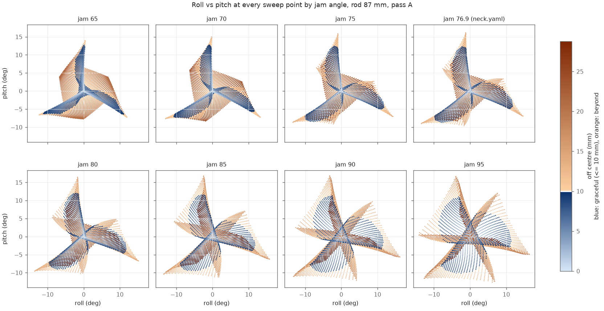

The main trade-off is that the head movement becomes less centred as the jam angle increases. You also get similar "leverage costs" to decreasing the rod length.

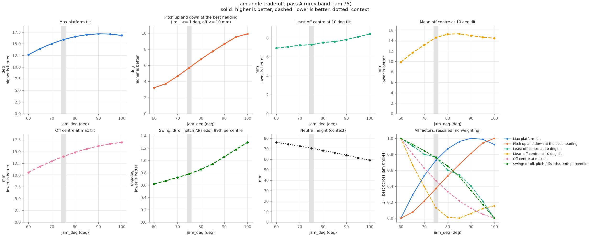

### 5.5 The look up vs look down trade-off

Depending on configuration, the neck joint either looks up better or looks down better, depending on being aligned with a nod line, or being 60° off.

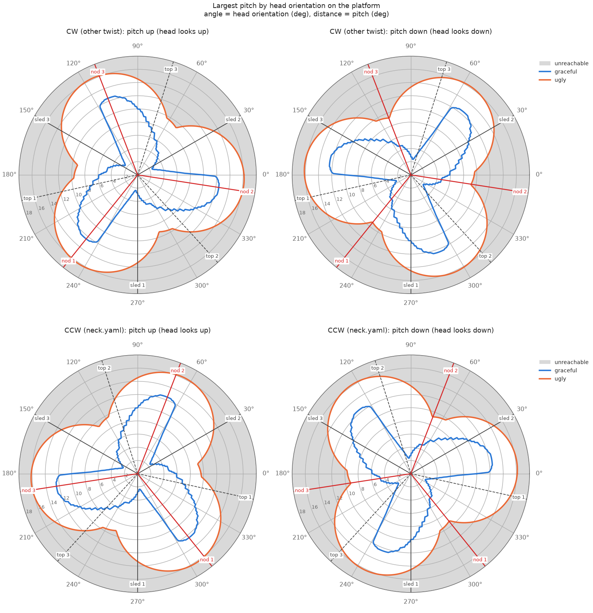

As it turns out, manually twisting the head platform between the two stable poses lets you (basically) choose between the look up/down modes, regardless of neck geometry.

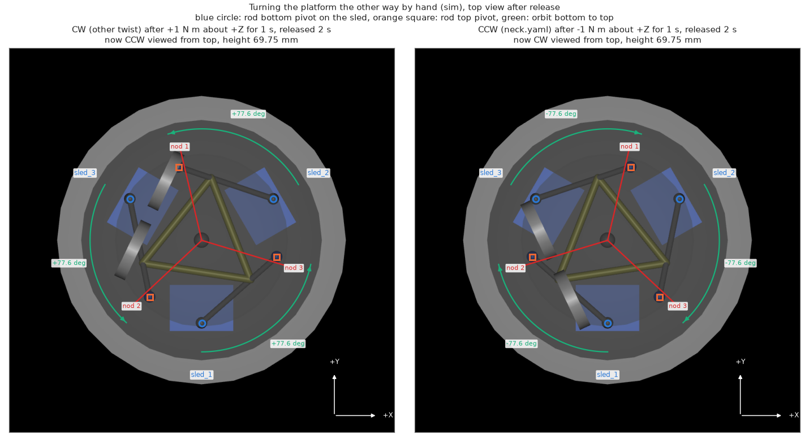

| Twist | Up (graceful) | Down (graceful) | Up (ugly) | Down (ugly) |
|-------|--------------:|----------------:|----------:|------------:|
| CW    |         11.6° |            5.0° |     15.9° |        9.1° |
| CCW   |          5.0° |           11.6° |      9.1° |       15.9° |

That's true of any type of neck, but the "polarity" changes, so depending on your build you may
need to twist it the other way.

Rod length affects the trade-off as well:

| Rod (mm) \ jam |         60 |         70 |         75 |         80 |         85 |         90 |         100 |
|---------------:|-----------:|-----------:|-----------:|-----------:|-----------:|-----------:|------------:|
|             70 | 3.0 / 16.2 | 4.5 / 17.3 | 6.8 / 10.5 |  9.0 / 8.5 | 11.2 / 8.7 | 13.6 / 9.0 | 17.6 / 11.0 |
|             87 | 2.4 / 12.3 | 3.6 / 12.7 | 5.0 / 11.6 |  6.4 / 7.7 |  8.2 / 7.1 |  9.2 / 6.3 | 10.2 /  6.9 |
|            115 |  1.8 / 8.9 |  2.9 / 8.9 |  3.7 / 8.4 |  4.6 / 8.0 |  5.3 / 6.5 |  6.0 / 5.1 |  6.5 /  4.7 |

_(Each cell is the graceful up / down in degrees.)_

The [lookaround] controller works well with this. It can set the preferred movement range of a neck, and use the eyes to give Robbie a good gaze, only going into the _ugly_ mode if the eyes are at full extent.

### 5.6 Putting it all together

First, **thanks for still being here**, those last few pages were a bit heavy.

Configuring your Robbie means making the neck.yaml file.

Rather than try and figure it out from the theory (above), there is a util that can take care of it. Run `just config`. If you don't know your rod jam limits (quite likely), you can measure the resting pose and this util will back-calculate it. You can also use the tabs to see the same charts we just discussed. So long as you could get the gist of what was covered here, you should be fine with the config util.

> [!NOTE]
> The last thing you need to do, is hit the "find best" button and get the angle from the "head" arrow. Then hit save. Put that value in into the OpenSCAD settings before printing the head.

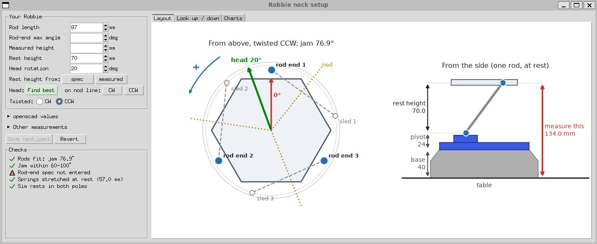

In robbie_commons.scad
 
    // from config util
    head_rotation = 20.0;


## 6.0 Inverse kinematics
(under construction)

## 7.0 Conclusion

IDK; after a document this long I kind of write a conclusion by reflex...
um...
IDK, if you DO build a Robbie please send me a photo.
That's all folks.

### 7.1 Related repos

- [robbie]: the umbrella project (layers A and B), and `robbie_interfaces`.
- [robbie_openscad]: 3D-printable parts and assembly.
- [robbie_restoration]: eye rendering and display drivers being salvaged.
- [lookaround]: natural gaze motion.

[robbie]: https://github.com/busyDuckman/robbie
[robbie_openscad]: https://github.com/busyDuckman/robbie_openscad
[robbie_restoration]: https://github.com/busyDuckman/robbie_restoration
[lookaround]: https://github.com/busyDuckman/look_around
[neck.yaml]: src/robbie_description/config/neck.yaml
[requirements.txt]: scripts/setup/requirements.txt

