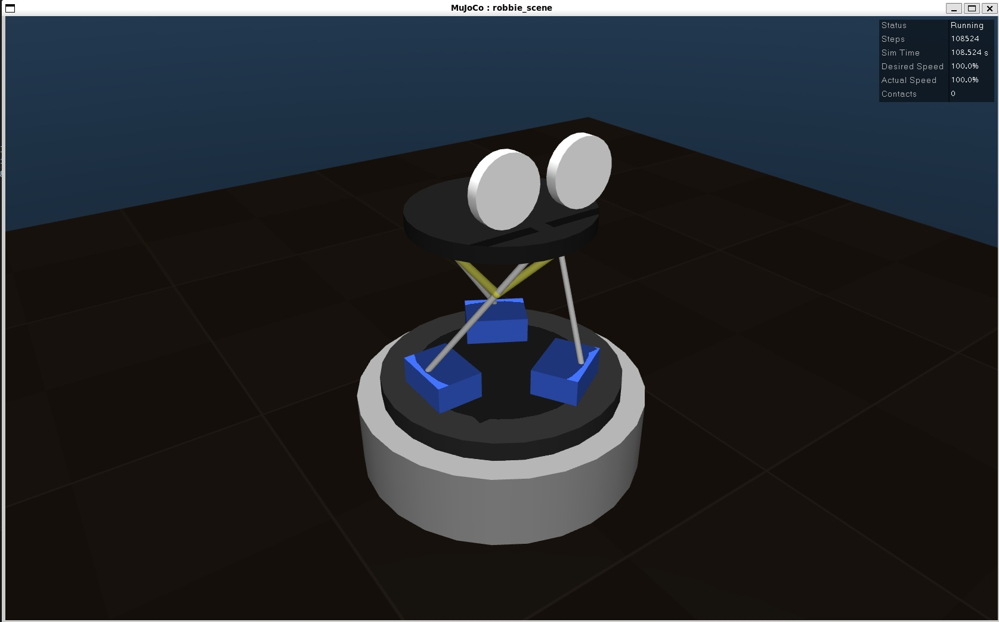

# robbie_ros

[](LICENSE)
[](#)
[](https://en.wikipedia.org/wiki/Technology_readiness_level)
[](https://docs.ros.org/en/jazzy/)
[](https://mujoco.org/)
[](https://rerun.io/)
[](https://www.raspberrypi.com/products/raspberry-pi-4-model-b/)
[](https://www.python.org/)
[](https://isocpp.org/)
[](https://youtu.be/8_o7KxZShpw)
[](https://github.com/busyDuckman/robbie)

Robot control for Robbie, a desktop robot with a moving head and two round LCD eyes.

robbie_ros is a ROS 2 system. It runs on a Raspberry Pi 4, or on the PC for simulation.


> Status: ROS 2 setup, deployment to PI-4 works, MuJoCo simulation.

## Where it fits

Robbie is built in three layers:

- **A, the LLM.**  AI control and dialogue.  
- **B, the harness.** State, attention, mood, camera, microphone and speakers. 
- **C, robot control.** This repo. Drives the neck motors, reads the sensors, runs gaze
  motion, and renders the eyes.

The first two layers live in the [robbie] repo. This repo is the third layer.

The harness talks to robbie_ros through a single ROS 2 bridge node. Nothing else in the
harness uses ROS. Standard ROS 2 message types are used where possible, so another ROS 2
robot could stand in for robbie_ros by remapping topics.

## What it does

- **Neck control.** Turns a desired head pose into sled motion, and keeps the sleds from colliding.
- **Homing.** Works out where the sleds are at power-on, using the encoders and a single
  shared home switch. It must work whatever order the sleds were assembled in.
- **Gaze.** Turns gaze targets from the harness into natural motion using [lookaround].
- **Unwinding.** The head can yaw through several full turns. robbie_ros unwinds it when
  needed, overriding or reinterpreting harness requests to do so.
- **Eyes.** Draws and animates the two eyes (gaze, blinks, lids, expression).
- **Safety.** Enforces joint limits, and stops safely if the harness goes silent or the
  e-stop is pressed.
- **Reporting.** Sends the harness the timestamped camera pose, whether the gaze target is
  reachable, status, and a heartbeat.

## The hardware

### The neck

- Three motorised sleds orbit a ring gear on a shared track.
- Three rods link the sleds to the head platform.
- Three springs each join a pair of neighbouring rods.
- Sleds spaced at 120 deg give a level head.
- Moving them in unison yaws the head, with unlimited turns.
- Moving them out of unison angles the head (roll/pitch).
- The sleds use geared N20 motors that can't be back-driven, so motor power can be cut once a pose is reached.

- The springs only return the system to one of two stable poses. 
   - They don't affect the dynamics, so any reasonable springs work.
   - It looks a lot like a three-sided tensegrity prism, but it's different. Like a tensegrity prism, the rods lock to a stable pose, but because the top and lower platforms are fixed (not flexible) the vertical ropes are not needed. 
   - if the 3-legged platform is fully torsioned (either way) it becomes stable because it binds the movement limits of the upper and lower rod ends. 
   - The springs do nothing except ensure that we don't leave the bound state.
   - manipulating the lower rod positions now controls the roll/pitch of the top platform.
   - yaw comes from all 3 moving together.
 
 **Notes for AI agents**: I have not found an AI agent that can figure out how the neck works. Any AI attempting to directly work on the neck should be wary, it is very likely to make mistakes.

### Sensors and outputs
  - One AS5600 magnetic encoder per sled pinion, one on each of the Pi's I2C buses.
  - One home switch, pressed by every sled as it passes.
  - Two GC9A01 round SPI LCDs for eyes.
  
  
## Photos etc
These photos are quite old; this repo is a re-implementation (using modern tools) of a device I made quite a few years ago.

<p>
  
  
</p>

Assembly animation (from [robbie_openscad]):

<a href="https://youtu.be/8_o7KxZShpw">
  
</a>


## Simulation

The simulation uses MuJoCo for physics and Rerun for visualisation and logging. It plugs in at the
hardware driver, so everything above the driver is the same code in sim and on the Pi.




From Linux or a WSL shell, after `just setup`:

```
just up              # build, then start the sim
just up --headless   # without the window
just down            # stop the simulation (don't just close the window)
```

Move the sleds from a second terminal (`just shell`). The values are orbit angles in radians;
0, 2.09 and 4.19 (120 deg apart) is level, and adding the same amount to all three yaws the head:

```
ros2 topic pub --once /sled_position_controller/commands std_msgs/msg/Float64MultiArray "data: [0.35, 2.09, 4.19]"
ros2 topic echo /joint_states                  # sled angles
ros2 topic echo /head_pose_broadcaster/pose    # the head's true pose (sim only)
```

In the viewer, double-click a part to select it, then Ctrl + right-drag to push it.

**Notes**

- The geometry lives in src/robbie_description/config/neck.yaml
  (The MuJoCo model is generated from it at build time)
- The rod ends jam at the stable pose, and the springs hold the neck there.
- The sim's springs are stiffer than the real ones. Softer springs in the sim result in the system moving to the other twist pose (stable pole) when doing large/fast movements. In reality thats not possible, without external force.


## Related repos

- [robbie]: the umbrella project (layers A and B), and `robbie_interfaces`.
- [robbie_openscad]: 3D-printable parts and assembly.
- [robbie_restoration]: eye rendering and display drivers being salvaged.
- [lookaround]: natural gaze motion.

[robbie]: https://github.com/busyDuckman/robbie
[robbie_openscad]: https://github.com/busyDuckman/robbie_openscad
[robbie_restoration]: https://github.com/busyDuckman/robbie_restoration
[lookaround]: https://github.com/busyDuckman/look_around
